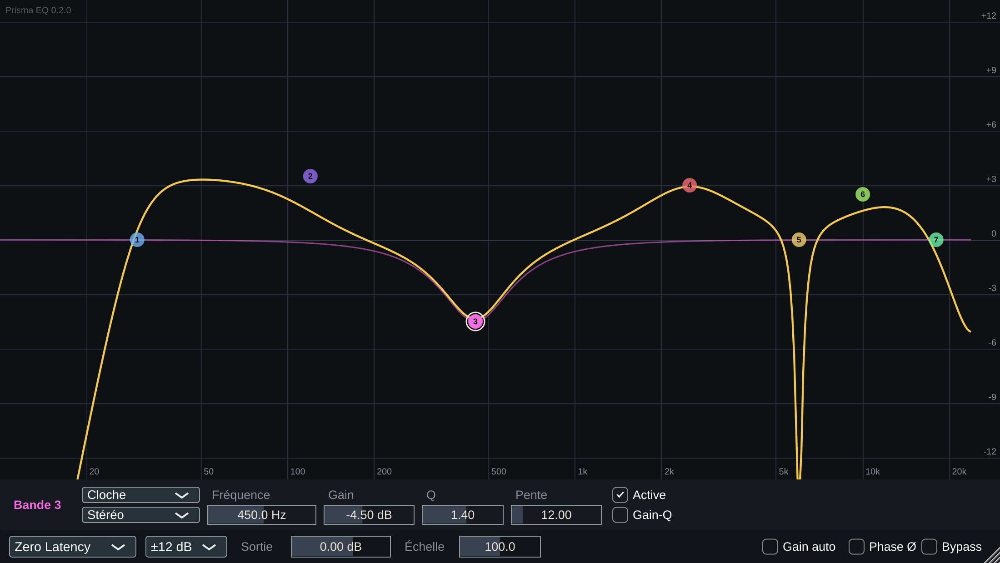

# Prisma EQ

Égaliseur paramétrique 24 bandes pour **Logic Pro** (Audio Unit), aussi disponible en VST3 et en application autonome. Binaire universel pour Mac Apple Silicon et Intel, macOS 11 ou plus récent. Conçu avec JUCE 8, en C++20.



**Version 0.2.0** : moteur Zero Latency complet et interface minimale. Les modes Natural Phase et Linear Phase, l'analyseur, la dynamique et les presets viendront dans les phases suivantes (voir [PLAN.md](PLAN.md) et [PROGRESS.md](PROGRESS.md)).

## Fonctionnalités
- **24 bandes et 10 formes** : cloche, plateau grave et aigu, coupe-bas et coupe-haut, encoche, passe-bande, plateau incliné, inclinaison (Flat Tilt), passe-tout.
- **Pentes** de 6 à 96 dB/oct, fractionnaires pour les coupes. Le brickwall vaut 96 dB/oct en Zero Latency.
- **Biquads « matched »** en double précision : la réponse suit le prototype analogique, sans écrasement près de Nyquist.
- **Placement par bande** : stéréo, gauche, droite, mid ou side.
- **Pas de zipper** : paramètres lissés et coefficients interpolés à chaque échantillon.
- **Sortie** :
  - gain et panoramique L/R ou M/S ;
  - inversion de phase ;
  - gain auto et échelle de gain ;
  - bypass doux de 20 ms.
- **Latence nulle.**

## Installer dans Logic Pro
1. Téléchargez `PrismaEQ-<version>-macOS.zip` depuis la [dernière release](https://github.com/Elliot-3686/prisma-eq/releases/latest), puis décompressez-le.
2. Copiez `Prisma EQ.component` dans `~/Library/Audio/Plug-Ins/Components/`. Pour d'autres logiciels, copiez aussi `Prisma EQ.vst3` dans `~/Library/Audio/Plug-Ins/VST3/`.
   - Le dossier `~/Library` est masqué : dans le Finder, choisissez **Aller › Aller au dossier…** (⇧⌘G), puis collez le chemin.
3. Dans le Terminal, lancez la commande ci-dessous. Elle est nécessaire parce que le plugin n'est pas notarié par Apple.
   ```bash
   xattr -dr com.apple.quarantine ~/Library/Audio/Plug-Ins/Components/"Prisma EQ.component"
   ```
4. Dans Logic Pro, ouvrez **Réglages › Gestionnaire de modules**, sélectionnez **Prisma Audio › Prisma EQ**, puis cliquez sur **Réinitialiser et réanalyser la sélection**.
5. Insérez-le sur une piste : **Audio Units › Prisma Audio › Prisma EQ**.

L'application autonome (`Prisma EQ.app`) se copie dans `/Applications`. Elle aussi a besoin de la commande `xattr` de l'étape 3, appliquée à son propre chemin.

### Si le plugin n'apparaît pas ou ne se charge pas
- **Vérifiez la validation** : dans le Terminal, `auval -v aufx PrEq Prsm` doit se terminer par « AU VALIDATION SUCCEEDED ».
- **Forcez une nouvelle analyse** : quittez Logic, lancez `killall -9 AudioComponentRegistrar`, puis rouvrez Logic.
- **Si macOS refuse toujours de le charger**, signez-le localement (signature ad hoc) :
  ```bash
  codesign --force --deep --sign - ~/Library/Audio/Plug-Ins/Components/"Prisma EQ.component"
  ```

### Mettre à jour ou désinstaller
Remplacez ou supprimez le `.component`, puis refaites l'étape 4. Le numéro de version s'affiche en haut à gauche de l'interface, ce qui permet de vérifier quelle compilation Logic a chargée.

## Utilisation
- **Double-clic sur le fond** : crée une cloche à cet endroit.
- **Glisser un point** : règle la fréquence et le gain.
- **Molette sur un point** : règle le Q, ou la pente pour les coupes.
- **Clic droit sur un point** : forme, pente, placement, activer ou supprimer.
- **Bandeau de la bande** : affiche les valeurs exactes. Cliquez sur une valeur pour la saisir (« 1,5 kHz », « 250 », « -3 »).
- **Barre du bas** :
  - mode de traitement (seul Zero Latency est actif pour l'instant) ;
  - échelle de l'afficheur (±3, 6, 12 ou 30 dB) ;
  - gain de sortie et échelle de gain ;
  - gain auto, inversion de phase et bypass.

## Qualité mesurée
Chaque affirmation sur la qualité du traitement est mesurée par un test :
- [rapport de tests](RAPPORT_TESTS.md), généré par la CI macOS ;
- écarts assumés et leur justification : [DECISIONS.md](DECISIONS.md).

En résumé :
- écart au prototype analogique ≤ 0,62 dB pour les bandes sous fs/16 ;
- pentes justes à 0,33 dB/oct près ;
- bruit de modulation ≤ −108 dB ;
- rendu identique au bit près quelle que soit la taille des blocs ;
- aucune allocation pendant le traitement.

## Compiler
Sur macOS (Xcode et CMake ≥ 3.25) :
```bash
cmake -S . -B build -G Ninja -DCMAKE_BUILD_TYPE=Release -DCMAKE_OSX_ARCHITECTURES="arm64;x86_64"
cmake --build build && ctest --test-dir build --output-on-failure
```
Sous Linux, et pour les tests seuls sans JUCE : voir [CLAUDE.md](CLAUDE.md).

## Licence
Code sous **AGPLv3** (voir `LICENSE`). JUCE est utilisé sous sa licence AGPLv3. Pour une diffusion commerciale en code fermé, il faudrait passer à une licence JUCE commerciale.

Les filtres reposent uniquement sur la littérature DSP publique :
- RBJ Audio EQ Cookbook ;
- M. Vicanek, *Matched Second Order Digital Filters* ;
- S. Orfanidis ;
- A. Oustaloup.

Prisma EQ n'est pas affilié à FabFilter. Aucun code, visuel ou preset de FabFilter n'est utilisé.
